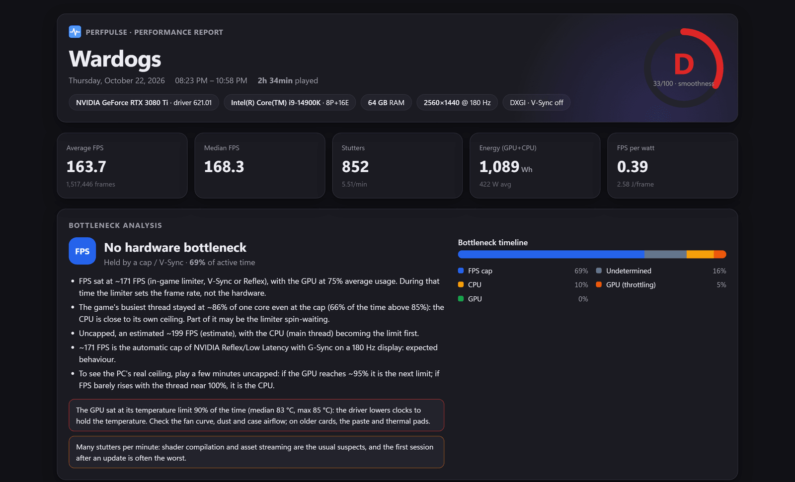
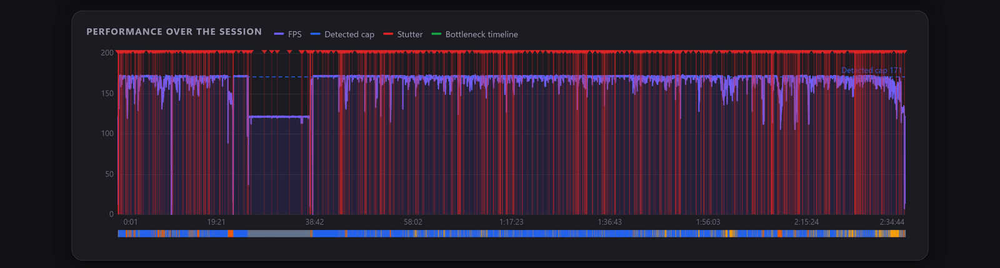
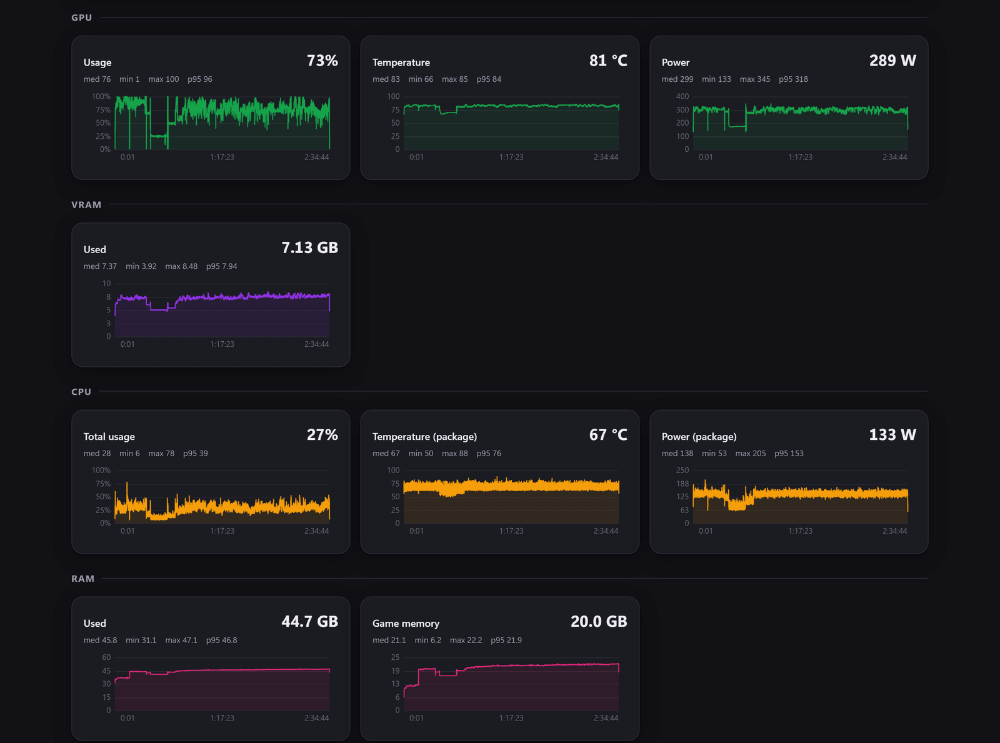
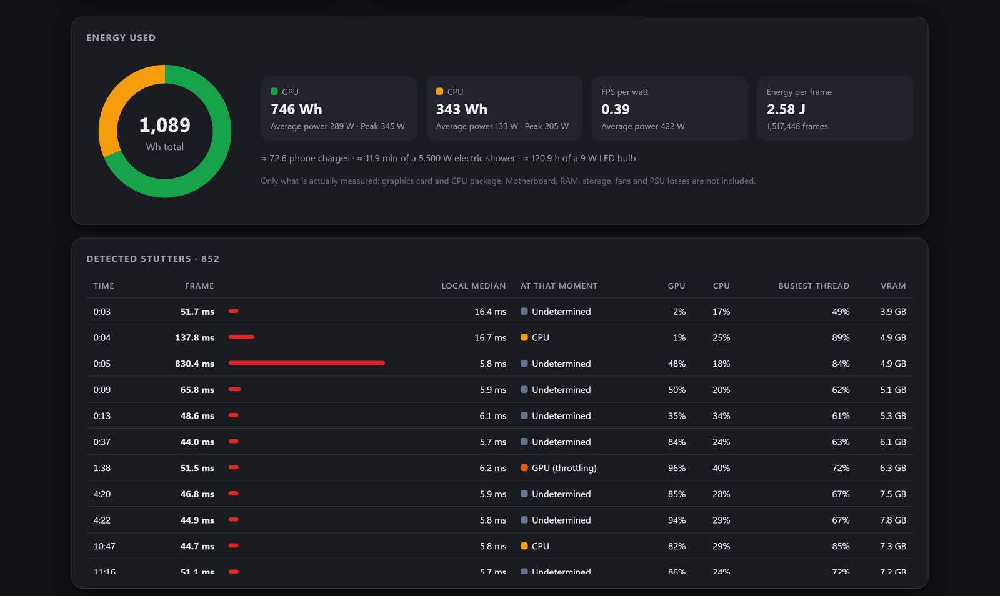

# PerfPulse

**English** · [Português](README.pt-BR.md)

Lightweight, injection-free game performance recorder for Windows: it sits in the tray,
notices on its own when a game starts, records FPS/frametime and sensors during the
session and, when the game closes, produces an **offline HTML report** with a summary,
averages, medians, a smoothness score, a **bottleneck diagnosis** (what the offender was
and when) and **energy consumed** by the GPU and CPU.

- A single `PerfPulse.exe` (~0.9 MB, C++20/Win32, no external runtime).
- ~0.7% of **one** core while recording; ~3 MB of RAM when idle.
- On hybrid CPUs (Intel 12th gen+), it runs in efficiency mode (EcoQoS) and leaves the P-cores to the game.

## Example report

A real 2h34 session of *Wardogs* (RTX 3080 Ti + i9-14900K, 1440p @ 180 Hz). The full report is in
[`docs/examples/`](docs/examples/): download the `.html` and open it in a browser, it works offline.



<details>
<summary>More sections: performance timeline, sensors, energy and stutters</summary>





</details>

## How it works

| Stage | Technique |
|---|---|
| Game detection | Every 2 s: foreground window on the chosen monitor, covering the screen (fullscreen or borderless) and presenting ≥ 10 frames/s for *N* seconds. "Always"/"never monitor" lists take priority. |
| FPS and frametime | Real-time ETW consumer (DXGI, D3D9 and DxgKrnl, the same method as PresentMon), with event ID filtering in the kernel. Every frame is recorded, which gives correct 1% and 0.1% lows. |
| NVIDIA GPU | NVML (usage, temperature, clocks, power, fan, VRAM, limiter) + NVAPI (hotspot, VRAM junction, voltage). |
| AMD/Intel GPU | WDDM: "GPU Engine"/"GPU Adapter Memory" counters + `D3DKMTQueryAdapterInfo` (temperature, clocks, fan, voltage). |
| CPU | Per-core usage and the **game's busiest thread** (NtQuerySystemInformation); effective clock (PDH); temperature and power via **PawnIO** → HWiNFO → LibreHardwareMonitor. |
| Report | Analysis in C++, a single HTML file with embedded canvas charts (no internet needed), PT-BR/EN, light/dark. |

Data stays in memory while you play: nothing is written to disk until the session ends.

## Requirements

- Windows 10 21H2+ or Windows 11, x64.
- Run as administrator (the manifest already requests it). Present ETW and PawnIO require elevation.
  The **Start with Windows** option creates an elevated scheduled task, so no UAC prompt appears at logon.
- For CPU temperature and power: [PawnIO](https://pawnio.eu) installed + modules in the `modules\` folder next to the exe
  (`tools\fetch_pawnio_modules.ps1`). Alternatives: HWiNFO with *Shared Memory Support* or LibreHardwareMonitor running.

## Building

Prerequisites: Visual Studio 2022 Build Tools (C++ workload, Windows SDK 10.0.22621+, CMake and Ninja).

```powershell
.\tools\fetch_pawnio_modules.ps1   # once: signed PawnIO modules
.\tools\build.ps1                  # Release + tests -> build\release\PerfPulse.exe
.\tools\build.ps1 -Config debug
```

Or directly with CMake, from a *Developer PowerShell*:

```powershell
cmake --preset release
cmake --build --preset release
ctest --preset release
```

> The repository can live on a UNC path (`\\wsl.localhost\...`); `build.ps1` maps a drive letter
> during the build, because CMake and Ninja don't handle UNC paths well.

## Usage

1. Run `PerfPulse.exe`. On first run the settings window opens; after that it goes straight to the tray.
2. Play. The icon turns amber while it confirms the game and gets a red dot while recording.
3. Close the game (or use **Stop recording** in the menu): the report goes to `Documents\PerfPulse\Reports`
   and the `index.html` in that folder compares all sessions per game.

Tray: **double-click** opens the settings; **right-click** shows the menu (enable/pause, latest report,
history, folder, demo report, exit).

### Command line

| Argument | Effect |
|---|---|
| `--autostart` | Used by the logon task (doesn't open the settings on first run). |
| `--diag [--out file.txt]` | Diagnostics: sensor sources, 3 samples and per-process *present* rate for 10 s. |
| `--demo-report [--out file.txt]` | Generates a report from an 18-minute synthetic session. |
| `--exit` | Asks the running instance to save the current session's report and exit. |
| `--reanalyze report.html [--to new.html]` | Re-runs the bottleneck analysis of an old report with the current rules and template (in place, unless `--to` is given) and updates the history next to it. Frame statistics stay as originally recorded, because raw frames are not saved. |

## The report

- **Summary**: game, date, duration (active × background time), hardware, resolution, API and V-Sync.
- **KPIs**: average and median FPS, 1% and 0.1% lows, median/p99 frametime, stutters per minute, Wh and FPS per watt.
- **Smoothness score** from 0 to 100 (S/A/B/C/D): local consistency (45%), stutters per minute (35%) and frame-to-frame regularity (20%).
- **Bottleneck**: each sample is classified as GPU, GPU (throttling), CPU, CPU (thermal), VRAM, RAM, FPS cap,
  undetermined, loading or background. The report shows the timeline, the main offender and specific tips.
- **Stutters**: every hitch, with its timestamp and the hardware state at that moment.
- **Sensors**: one chart per chosen metric, with average, median, minimum, maximum and p95.
- **Energy**: GPU and CPU Wh (only what is actually measured), average and peak power, energy per frame.

## Layout

```
src/
  core/       config, JSON, i18n, metrics, paths, log
  capture/    ETW present consumer
  detection/  game detector, monitors, process info
  sensors/    NVIDIA, generic WDDM, CPU, PawnIO/HWiNFO/LHM, memory
  session/    session data model and recorder
  analysis/   frame statistics, stutter, score, bottleneck, energy
  report/     JSON payload, HTML generator, history, demo session
  app/        tray, settings window, theme, autostart, diagnostics
resources/    icon, manifest, HTML templates for the report and history
tests/        unit tests (ctest) and a D3D11 "fake game" for end-to-end tests
tools/        build, icon and PawnIO module download
docs/         architecture and coding style
```

See [docs/architecture.md](docs/architecture.md) and [docs/coding-style.md](docs/coding-style.md).

## Known limitations (v0.1)

- No in-game overlay (phase 2).
- On AMD/Intel, GPU power in watts isn't exposed by WDDM: it stays "not measured" until ADLX/IGCL integration.
- Energy only covers the GPU and CPU package; motherboard, RAM, SSD, fans and PSU losses are left out.
- FPS = the application's *Present* call rate (like PresentMon's "FPS"), not frames shown by the monitor.
